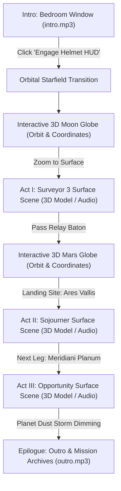

# 🚀 MASTER PLAN: *Echoes in the Dust: The Cosmic Relay Race*
**NASA Space Apps Challenge 2026**  
**Challenge:** *Abandoned but Not Forgotten: Storytelling about NASA's Discarded Equipment on the Moon and Mars*  
**Format:** Immersive 3D Web Scrollytelling + Orbital Globe Explorer + 3D Hardware Inspector  
**Target Audience:** School-Age Kids (Ages 7–14), Space Enthusiasts, Educators, and NASA Judges  
**Core Technologies:** React + Vite + Tailwind CSS + Three.js / React Three Fiber + GSAP / Framer Motion  

---

## 1. Executive Summary & Challenge Alignment

### 1.1 The Challenge Core
Decades of space exploration have left iconic robots and landers resting silently in the lunar regolith and Martian dust. While contemporary news highlights active rovers and the Artemis program, these pioneering machines laid the scientific and engineering foundation for interplanetary travel.

### 1.2 Our Vision: *"The Great Cosmic Relay Race"*
Rather than a dry static catalog or list of discarded scrap, *Echoes in the Dust* frames three historic missions as teammates passing an interplanetary exploration baton across space and time:
1. **Act I: Surveyor 3 (The Moon, 1967)** — *The Scout Who Tested the Dust* (Proved soft lunar soil could support landers; visited by Apollo 12).
2. **Act II: Sojourner (Mars, 1997)** — *The Bouncy Pioneer* (Bounced on airbags; proved mobile wheels and autonomous navigation on another world).
3. **Act III: Opportunity / "Oppy" (Mars, 2004–2018)** — *The Grand Marathon Runner* (45.16 km marathon; discovered ancient water; 15-year testament to engineering endurance).
4. **Epilogue: The Torch Passes to YOU** — The astronaut visor lifts, challenging the next generation standing at their bedroom windows to pick up the next relay leg.

### 1.3 Key Hackathon Criteria Met
* **NASA NSSDCA Data Integration:** Real launch masses, landing coordinates, and scientific instruments woven organically into narratives.
* **The "Engineer-to-Product" Emotional Bond:** Highlighting the human teams behind the hardware (Hughes Aircraft, Donna Shirley's JPL team, Steve Squyres and scientists living on "Mars time").
* **Multi-Tiered Presentation:** Kid-friendly poetic narration + technical "NASA Secret Science File" / "Tech-Patch" badges for judges and enthusiasts.

---

## 2. Interactive Navigation: Scrollytelling + 3D Orbital Globe

Based on project requirements, navigation blends **Continuous Scrollytelling** with an **Interactive 3D Planet Viewer**:



### 2.1 Two Synced Exploration Modes
1. **Cinematic Story Mode (Scrollytelling):**
   * As the audio tracks play, the camera smoothly guides the user from Earth into orbit, descending to the Moon, journeying to Mars, and landing at each mission coordinate.
   * Karaoke-style telemetry text highlights line-by-line in sync with the narration.
2. **Interactive 3D Planetary & Hardware Inspection Mode:**
   * At any moment (or at designated checkpoints), the user can toggle the **Orbital Globe Viewer** to rotate 3D celestial bodies (Moon & Mars), inspect landing sites, and interact with **real-time 3D models** of the spacecraft.

---

## 3. Visual Assets & 3D Model Architecture (Tri-Layer Visuals)

Each mission is brought to life through three complementary visual layers:

### 3.1 Layer 1: Real-Time Interactive 3D Models (.glb / .gltf / Three.js)
* **Surveyor 3:** 3-legged triangular lander, solar panel mast, omnidirectional antenna, and articulated surface soil sampling scoop.
* **Sojourner:** 6-wheeled micro-rover featuring its distinctive rocker-bogie suspension, APXS instrument deployed at the rear, and solar top-plate.
* **Opportunity (Oppy):** Iconic solar-winged MER rover, panoramic camera mast (Pancam), and robotic arm (IDD) with the Rock Abrasion Tool (RAT).
* **Interactive Controls:** Orbit, zoom, and click designated hot-spots on the 3D models to reveal component functions (e.g., clicking Oppy's wheels explains Martian tread wear; clicking the scoop explains lunar regolith testing).

### 3.2 Layer 2: Custom Digital Artwork & Illustrations
* Dedicated slots and parallax canvas layers for custom digital art, character artwork (the child explorer), and stylized planetary landscapes.
* Stylized 2.5D visual dioramas separating foreground rocks, midground rovers, and deep-space nebulae.

### 3.3 Layer 3: Official NASA Archival Imagery & Blueprints
* High-resolution official NASA / JPL archival photos:
  * **Surveyor 3:** `PIA00358` (Surveyor 3 on the Moon) and Apollo 12 astronaut Pete Conrad examining the lander (`AS12-48-7133`).
  * **Sojourner:** `PIA01122` (Sojourner analyzing rock "Yogi") and airbag deflation views.
  * **Opportunity:** `PIA22359` (Selfie / tracks across Endeavour Crater) and microscopic images of hematite spherules ("blueberries").
* **X-Ray / Blueprint Mode:** Neon glowing wireframe overlays that reveal internal schematics when scanned with the custom cursor.

---

## 4. Audio Pipeline & Scene Breakdown

All five existing voiceover tracks from `asset/audio/` are mapped 1-to-1:

| Track # | Audio File Path | Scene / Stage | Interactive & Visual Actions |
|---|---|---|---|
| **01** | `asset/audio/intro.mp3` | **Prologue: Bedroom Window** | Dark cozy bedroom; frosted window; child gazing at stars. Glowing prompt: "ENGAGE HELMET HUD". Triggers Three.js starfield warp. |
| **02** | `asset/audio/surveyor (2nd part).mp3` | **Act I: Moon (Oceanus Procellarum)** | 3D Moon globe rotates to coordinates (3.01° S, 23.42° W). Surface descent reveals Surveyor 3. Interactive scoop inspection and Apollo 12 visit lore. |
| **03** | `asset/audio/sojourner (3rd part).mp3` | **Act II: Mars (Ares Vallis)** | Interplanetary transit to Mars (19.33° N, 33.55° W). Airbag bounce animation. 3D micro-rover model, rocker-bogie test, and Donna Shirley JPL team story. |
| **04** | `asset/audio/oppy (4th part).mp3` | **Act III: Mars (Meridiani Planum)** | Traverse across Martian ridge (1.95° S, 354.47° E). 45.16 km odometer tracker. 3D Oppy model; dust storm simulation dims solar energy readout. |
| **05** | `asset/audio/outro.mp3` | **Epilogue: The Cosmic Relay** | Astronaut visor lifts; orbital relay lines connect Moon & Mars to Earth. Mission control archive open for exploration; replay triggers. |

### Audio Dock Features
* Persistent glassmorphism control dock at bottom of screen.
* Play/Pause, timeline scrubber, track switcher, volume control, and mute.
* Telemetry readout displaying current track timecode, audio frequency bars, and synchronized karaoke subtitles.

---

## 5. System & Component Architecture

```text
nasa-echoes-in-the-dust/
├── public/
│   ├── audio/
│   │   ├── intro.mp3
│   │   ├── surveyor (2nd part).mp3
│   │   ├── sojourner (3rd part).mp3
│   │   ├── oppy (4th part).mp3
│   │   └── outro.mp3
│   ├── models/                  # 3D GLTF/GLB models
│   │   ├── surveyor3.glb
│   │   ├── sojourner.glb
│   │   ├── opportunity.glb
│   │   ├── moon.glb
│   │   └── mars.glb
│   └── images/
│       ├── nasa-archive/        # Official JPL / NSSDCA images
│       └── custom-art/          # Custom digital artwork & backgrounds
├── src/
│   ├── components/
│   │   ├── 3d/
│   │   │   ├── PlanetaryGlobe.jsx  # Interactive 3D Moon & Mars Globe
│   │   │   ├── HardwareViewer.jsx  # Interactive 3D Rover/Lander Inspector
│   │   │   └── SpaceAtmosphere.jsx # Three.js particle starfield & dust
│   │   ├── hud/
│   │   │   ├── HelmetVisor.jsx     # Glassmorphism visor frame & telemetry
│   │   │   ├── ScannerCursor.jsx   # X-Ray blueprint spotlight mask
│   │   │   └── TelemetryBadges.jsx # Live coordinates, oxygen, battery HUD
│   │   ├── player/
│   │   │   ├── AudioDock.jsx       # Floating retro-futuristic controller
│   │   │   └── KaraokeSubtitles.jsx# Synced narration subtitles
│   │   ├── scenes/
│   │   │   ├── WindowScene.jsx     # Prologue bedroom scene
│   │   │   ├── MissionScene.jsx    # Dynamic template for Surveyor, Sojourner, Oppy
│   │   │   └── OutroScene.jsx      # Final relay summary & mission logs
│   │   └── modals/
│   │       └── TechPatchModal.jsx  # Dual view: 3D Model <-> Art <-> NASA Archive
│   ├── data/
│   │   └── missionsData.js         # Specs, NSSDCA facts, quotes, coordinates
│   ├── hooks/
│   │   └── useAudioSync.js         # Audio timeline and sync hook
│   ├── App.jsx
│   ├── index.css
│   └── main.jsx
├── package.json
└── vite.config.js
```

---

## 6. Official NSSDCA Science & Human Connection Matrix

| Mission | Location & Date | Key Engineering Specs (NSSDCA) | The Human Connection |
|---|---|---|---|
| **Surveyor 3** | Moon (*Oceanus Procellarum*)<br>April 20, 1967 | Launch: 1,026 kg; Landing: 296 kg.<br>Electric soil scoop with strain gauge.<br>Television camera transmitted 6,315 pictures. | Hughes Aircraft engineers held their breath as the scoop scraped lunar soil to disprove quicksand theories. Visited in Nov 1969 by Apollo 12 astronauts Conrad and Bean—the only probe visited by humans off-world. |
| **Sojourner** | Mars (*Ares Vallis*)<br>July 4, 1997 | 11.5 kg micro-rover, 13W solar peak.<br>6-wheel Rocker-Bogie mobility.<br>Alpha Particle X-Ray Spectrometer (APXS). | Led by Donna Shirley and a scrappy JPL team battling naysayers; engineers felt every bump over rocks like a human heartbeat. Proved micro-rovers can operate on Mars. |
| **Opportunity (Oppy)** | Mars (*Meridiani Planum*)<br>January 25, 2004 | 185 kg, Rock Abrasion Tool (RAT), Mini-TES.<br>Designed for 90 days / 1,000 meters;<br>Achieved 15 years / 45.16 km marathon. | Steve Squyres and flight operators lived on "Mars time" (sliding sleep by 40 minutes every day). Team mourned Oppy after the 2018 global dust storm like a faithful companion. |

---

## 7. Review & Verification Checklist Before Code Execution

- [x] All 5 audio files accounted for without any re-recording.
- [x] Dual exploration mode defined: Scrollytelling + 3D Orbital Globe.
- [x] Visual pipeline confirmed: 3D interactive models + custom artwork slots + NASA archival imagery + blueprint wireframes.
- [x] NSSDCA facts and emotional human bonds articulated for judges.
- [ ] User review and approval of the master blueprint.
- [ ] Ready signal to scaffold Vite + React + Three.js project.
